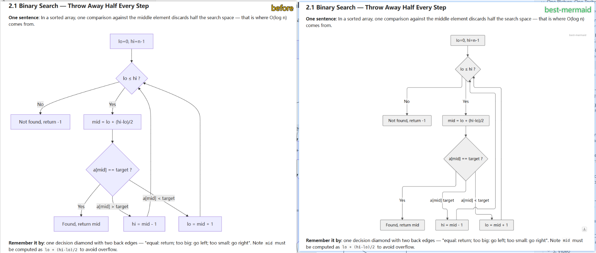
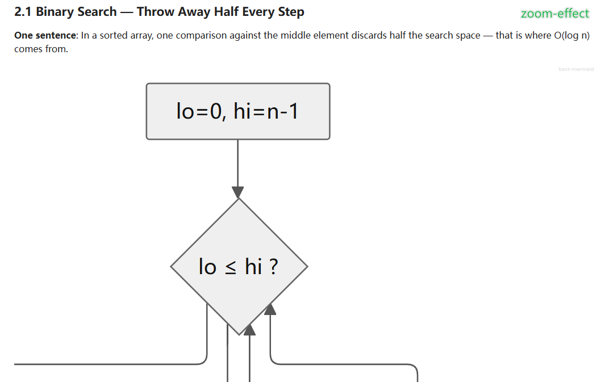
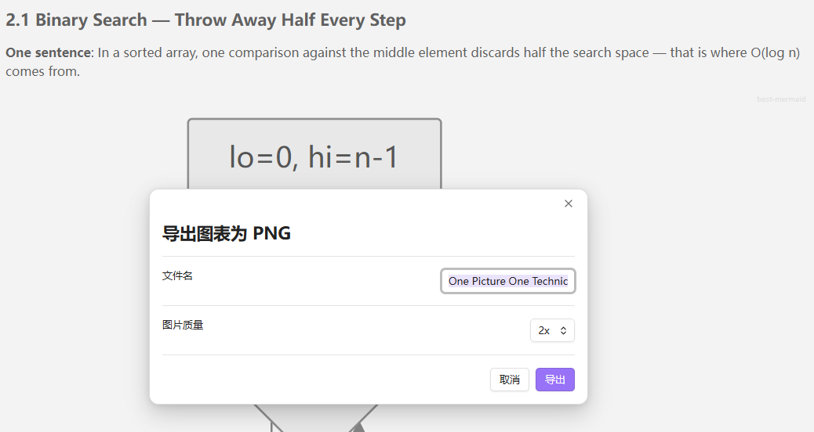
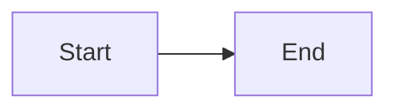
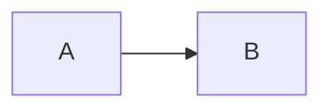
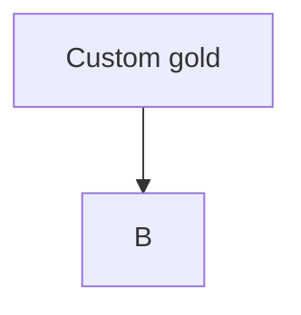

# Best Mermaid

English | [简体中文](./README.zh-CN.md)

**Diagrams that feel like they belong in your notes.**

Your notes have a theme. Your diagrams don't — the same purple boxes, mismatched fonts, and edges that cross like spaghetti. Best Mermaid re-renders every mermaid diagram in your vault with your theme's own colors, curated styles, and professional layout. No configuration. No new syntax.

Install it, open a note, and it just looks right.

- ✦ **Zero config** — your existing diagrams look better the moment the plugin loads
- ✦ **Follows your theme** — light/dark, custom CSS, accent colors: diagrams dress accordingly
- ✦ **Style packs** — one line switches a diagram to a print-ready or presentation look
- ✦ **Stays offline** — mermaid and elk are bundled; nothing leaves your vault



*Left: the default Obsidian mermaid renderer. Right: Best Mermaid with the Paper style — theme-matched grayscale palette and clean orthogonal routing.*



*`Ctrl` + scroll zooms at the cursor (trackpad pinch works too); drag to pan; double-click to reset — zoom stays put across re-renders.*



*Click the download icon at the bottom-right of any diagram: edit the file name, pick 1x–4x quality, and save anywhere through the native save dialog.*

## Why another mermaid plugin?

There are several mermaid appearance plugins already. Best Mermaid differs in a few ways:

- **Style packs, not just color tweaks.** Each style is a complete, self-describing card: palette, typography, line style, spacing, and even the layout engine. Switching a style re-lays out the diagram.
- **Theme fusion.** Diagram colors are resolved from your theme's CSS variables through a probe element, so diagrams follow your light/dark theme (and custom theme CSS) instead of mermaid's fixed palettes.
- **Style choice travels with the diagram.** A per-diagram directive in the code block keeps your style choice when you copy the block or sync the note.
- **Engine and style are linked.** The print-oriented style automatically uses the elk layout engine for orthogonal routing; other styles use dagre. You can also pin the engine in settings.

## Features

- **Take over rendering** of ` ```mermaid ` blocks in reading view, replacing the built-in renderer
- **Style packs** with a gallery in settings — 4 built-in styles:
  - *Follow theme* — colors resolved from Obsidian CSS variables, follows light/dark
  - *Midnight* — slate night + indigo accent for screenshots and presentations
  - *Paper* — black & white orthogonal routing (elk), print/export friendly
  - *Terra* — warm, humanist palette for teaching and sharing
- **Per-diagram style override** that lives in the diagram source
- **`%%{init}%%` directives respected** — in-diagram directives merge over plugin settings (user intent always wins); `themeCSS` appends instead of replacing
- **Layout engine**: dagre (default) or elk with orthogonal edge routing, switched per style, per diagram, or globally
- **Pan & zoom**: `Ctrl` + scroll to zoom at the cursor (trackpad pinch works), drag to pan, double-click to reset; zoom state survives re-renders
- **Horizontal alignment** of rendered diagrams (left / center / right)
- **Readable errors**: syntax problems render as a visible error box with the offending line, never a silent blank
- **Render cache + serial render queue**: concurrent diagrams can't clobber each other's config; identical diagrams render once
- **Fully offline** — mermaid and elk are bundled, no network requests, no telemetry

## Usage

Write mermaid blocks as usual:

````markdown

````

Pin a style to a diagram (the directive is a comment — Obsidian without this plugin ignores it safely):

````markdown

````

In-diagram customization still works and takes priority over the plugin:

````markdown

````

### Built-in style ids

| id | name | notes |
|---|---|---|
| `follow` | Follow theme | dynamic, resolves theme CSS variables |
| `midnight` | Midnight | static, dark presentation look |
| `paper` | Paper | static, orthogonal routing via elk |
| `terra` | Terra | static, warm humanist palette |

## Interactions (reading view)

| Action | Effect |
|---|---|
| `Ctrl` + scroll / trackpad pinch | zoom anchored at cursor (0.2×–8×) |
| Drag (when zoomed) | pan |
| Double-click | reset to 100% |
| Zoom out below 100% and pause | snaps back to fit |

## Limitations

- Live Preview (editing view) still uses Obsidian's built-in mermaid renderer; this plugin takes over the reading view
- Desktop only for now (`isDesktopOnly: true`); the bundle includes mermaid + elk (~12 MB)

## Development

```bash
npm install
npm run dev     # esbuild watch
npm test        # vitest + jsdom, real mermaid render pipeline tests
npm run build   # type-check + production bundle
```

Manual install for testing: copy `main.js`, `manifest.json`, `styles.css` into `<vault>/.obsidian/plugins/best-mermaid/`.

## License

[MIT](LICENSE)
