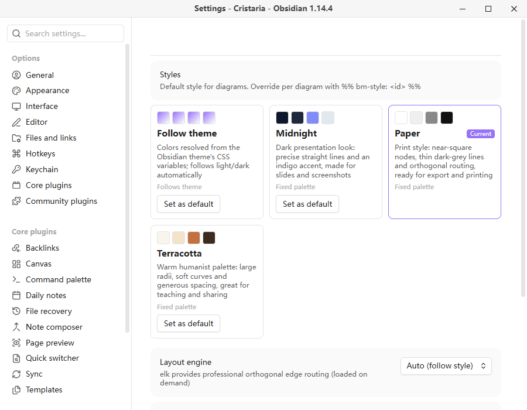
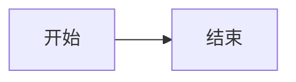
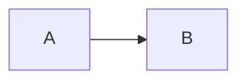
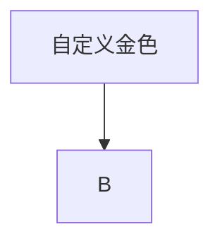

# Best Mermaid

[English](./README.md) | 简体中文

**让图，终于像你笔记的一部分。**

你的笔记有主题，你的图却没有——永远是那套紫色方块、不搭的字体、搅成一团的连线。Best Mermaid 用你主题自己的配色、精选的样式和专业的布局，重新渲染 vault 里的每一张 mermaid 图。无需配置，不用学新语法。

装上，打开笔记，它看起来就对了。

- ✦ **零配置** —— 插件启用的一刻，现有图立刻变好看
- ✦ **跟随主题** —— 亮暗模式、自定义 CSS、强调色，图都会跟着换装
- ✦ **样式卡** —— 一行指令让图切换到印刷风或演示风
- ✦ **完全离线** —— mermaid 与 elk 均已打包，数据不出 vault


*左：Obsidian 默认 mermaid 渲染。右：Best Mermaid 的论文黑白样式——贴合主题的灰阶配色与干净的正交布线。*


*`Ctrl` + 滚轮以光标为中心缩放（触控板捏合同样有效）；拖拽平移、双击复位——缩放状态在重渲染后保留。*


*点击任意图右下角的下载图标：可编辑文件名、选择 1x–4x 图片质量，并通过系统保存对话框选择任意位置保存。*



*设置页的样式画廊：四套内置样式卡，色板所见即所得。在这里选择全局默认；单图可用 `%% bm-style: <id> %%` 单独覆盖。*

## 为什么还要一个 mermaid 插件？

已有的 mermaid 外观插件不少，Best Mermaid 的不同在于：

- **样式卡，而不只是调色。** 每套样式是一张完整的自描述卡片：配色、字号、线型、间距，甚至布局引擎。切换样式即重新排版整张图。
- **主题融合。** 图的颜色通过探针元素从主题的 CSS 变量解析而来，跟随你的亮/暗模式与自定义主题 CSS，而不是 mermaid 的固定调色板。
- **样式选择跟着图走。** 写在代码块里的图级指令，让复制图块、同步笔记时选择不丢。
- **引擎与样式联动。** 印刷风样式自动使用 elk 引擎做正交布线，其他样式用 dagre；也可以在设置里手动锁定引擎。

## 功能

- **接管渲染**：阅读视图下的 ` ```mermaid ` 代码块由本插件渲染，替代内置渲染器
- **样式卡**：设置里有样式画廊，内置 4 套：
  - *跟随主题*——颜色解析自 Obsidian CSS 变量，自动跟随亮暗
  - *靛夜*——石板夜色 + 靛蓝点睛，适合截图与演示
  - *论文黑白*——黑白正交布线（elk），导出打印友好
  - *赤陶*——暖调人文风，适合教学与分享
- **图级样式覆盖**：样式选择随图走
- **尊重 `%%{init}%%` 指令**：图内指令合并优先于插件设置（用户意图永远最高）；`themeCSS` 采用追加而非整体替换
- **布局引擎**：dagre（默认）或 elk（专业正交布线），按样式、按图、或全局切换
- **缩放与平移**：`Ctrl` + 滚轮以鼠标为锚点缩放（支持触控板双指捏合）、拖拽平移、双击复位；缩放状态在重渲染后保留
- **水平对齐**：渲染图在容器内左/中/右对齐
- **错误可视化**：语法错误显示为带出错行定位的错误框，绝不静默空白
- **渲染缓存 + 串行队列**：并发渲染不会互相覆盖配置；相同的图只渲染一次
- **完全离线**：mermaid 与 elk 均为本地打包，无网络请求、无遥测

## 用法

像平时一样写 mermaid：

````markdown

````

给某张图固定样式（指令是注释——没装本插件的 Obsidian 会安全忽略）：

````markdown

````

图内自定义依然可用且优先级最高：

````markdown

````

### 内置样式 id

| id | 名称 | 说明 |
|---|---|---|
| `follow` | 跟随主题 | 动态，解析主题 CSS 变量 |
| `midnight` | 靛夜 | 固定，深色演示风 |
| `paper` | 论文黑白 | 固定，elk 正交布线 |
| `terra` | 赤陶 | 固定，暖调人文风 |

## 交互（阅读视图）

| 操作 | 效果 |
|---|---|
| `Ctrl` + 滚轮 / 触控板捏合 | 以光标为锚点缩放（0.2×–8×） |
| 拖拽（放大后） | 平移 |
| 双击 | 复位到 100% |
| 缩小到 100% 以下并停手 | 自动吸附回适合宽度 |

## 已知边界

- 实时预览（编辑视图）仍使用 Obsidian 内置渲染器；本插件接管阅读视图
- 暂仅桌面端（`isDesktopOnly: true`）；bundle 含 mermaid + elk（约 12 MB）

## 开发

```bash
npm install
npm run dev     # esbuild watch
npm test        # vitest + jsdom，真实渲染管线回归测试
npm run build   # 类型检查 + 生产构建
```

手动测试安装：把 `main.js`、`manifest.json`、`styles.css` 拷入 `<vault>/.obsidian/plugins/best-mermaid/`。

## 许可证

[MIT](LICENSE)
